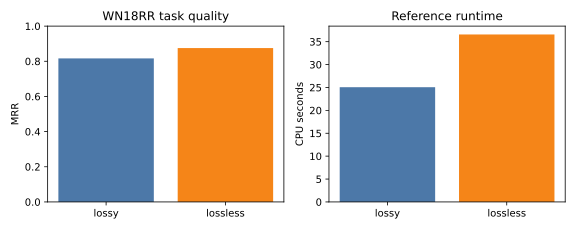
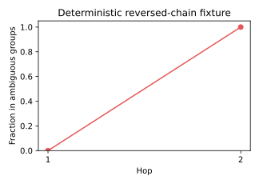

# Reproducible experiment figures

The figures below are generated only from committed CSV outputs:

```bash
python scripts/render_docs_figures.py
```

## WN18RR quality and runtime



The source values reproduce the authors' PAM/BoP experiment log. They describe
that environment and are not promised package benchmarks.

## Collision fixture by hop



This is the deterministic item-02 reversed-chain fixture: the two ordered
signatures `(r, s)` and `(s, r)` are distinct but ordinary multiplication maps
both to the same scalar at hop two. Repeated instances of one signature do not
create another distinct signature and therefore are not counted as a collision.
